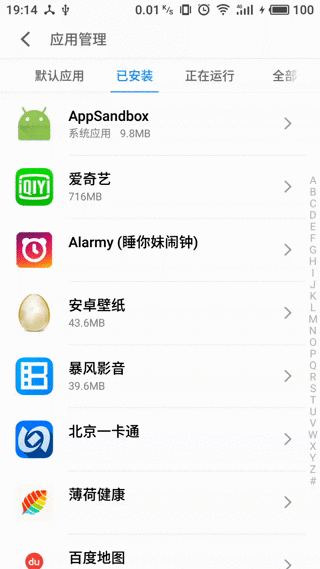
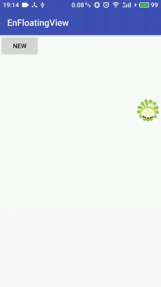

[](https://imuxuan.com/)

EnFloatingView
==========================
[](https://github.com/leotyndale/EnFloatingView/stargazers)
[](https://github.com/leotyndale/EnFloatingView)
[](https://imuxuan.com/)
[](https://blog.imuxuan.com/)

[中文文档](/README.md)

**Permission-free in-app floating window for Android** — works out of the box across all OEM ROMs (MIUI/HyperOS, ColorOS, OriginOS, EMUI/HarmonyOS, OneUI) with zero `SYSTEM_ALERT_WINDOW` prompts.

Architecture Deep Dive: [EnFloatingView Internals](https://blog.imuxuan.com/archives/92) · [ForDeer Blog](https://blog.imuxuan.com/) · [imuxuan.com](https://imuxuan.com/)

---

### Why Not Traditional System Floating Windows?

Traditional Android floating windows rely on two system approaches, both with major UX friction:

1. **`TYPE_SYSTEM_ALERT` / `TYPE_APPLICATION_OVERLAY`**:
   ```java
   mWindowManager = (WindowManager) context.getSystemService(Context.WINDOW_SERVICE);
   WindowManager.LayoutParams layoutParams = new WindowManager.LayoutParams();
   layoutParams.type = WindowManager.LayoutParams.TYPE_SYSTEM_ALERT;
   ```
   Requires declaring `<uses-permission android:name="android.permission.SYSTEM_ALERT_WINDOW" />` and sending users into system settings to grant overlay permission.

2. **`TYPE_TOAST` / `TYPE_PHONE` Workarounds**:
   Blocked on Android 7.1.1+ and hidden by default on Chinese OEM ROMs (Xiaomi, Huawei, Meizu, OPPO, vivo), forcing awkward permission-guide dialogs:



---

### Features

- **Zero Permissions Required**: Displays directly inside your app window (`android.R.id.content`) without `SYSTEM_ALERT_WINDOW`.
- **100% OEM ROM Compatible**: Shows by default on all Android devices without routing users to system settings.
- **Smooth Drag & Edge Snapping**: Built-in touch dragging, screen-bounds clamping, and magnetic edge snapping.
- **Jetpack Compose & Custom View Ready**: Host XML layouts, custom `View`s, or `ComposeView` effortlessly.

---

### Quick Start (View / XML)

1. Add the dependency in `build.gradle`:
   ```groovy
   implementation 'com.imuxuan:floatingview:1.6'
   ```

2. Attach and detach in your base `Activity` `onStart` / `onStop` (or via `Application.ActivityLifecycleCallbacks`):
   ```java
   @Override
   protected void onStart() {
       super.onStart();
       FloatingView.get().attach(this);
   }

   @Override
   protected void onStop() {
       super.onStop();
       FloatingView.get().detach(this);
   }
   ```

3. Show or remove the floating view:
   ```java
   FloatingView.get().add();
   // Dismiss when no longer needed:
   FloatingView.get().remove();
   ```

---

### Jetpack Compose Interoperability (Kotlin)

You can host any Jetpack Compose UI inside `EnFloatingView` while keeping magnetic edge-snapping and zero-permission display by subclassing `FloatingMagnetView`:

```kotlin
class ComposeFloatingView(context: Context) : FloatingMagnetView(context) {
    init {
        addView(
            ComposeView(context).apply {
                setViewCompositionStrategy(ViewCompositionStrategy.DisposeOnDetachedFromWindow)
                setContent {
                    MaterialTheme {
                        Surface(shape = CircleShape, shadowElevation = 6.dp) {
                            Icon(
                                imageVector = Icons.Default.Star,
                                contentDescription = "Floating Action",
                                modifier = Modifier.padding(12.dp)
                            )
                        }
                    }
                }
            }
        )
    }
}

// Attach inside your BaseActivity / ComponentActivity:
FloatingView.get()
    .customView(ComposeFloatingView(applicationContext))
    .attach(this)
    .add()
```

---

### Preview



---

### More Open-Source Projects

| Project | Description | Stars |
| --- | --- | --- |
| [**mobile-agent-skills**](https://github.com/leotyndale/mobile-agent-skills) | Production AI Coding Agent Skills for Claude Code, Cursor, Codex, Antigravity & Gemini CLI |  |
| [**AppArchitecture**](https://github.com/leotyndale/AppArchitecture) | 2026 Mobile Architecture Engineering Playbook & companion code |  |
| [**EnCrashWhiteList**](https://github.com/leotyndale/EnCrashWhiteList) | Android ROM crash allowlist & `Looper.loop` defensive governance |  |
| [**EnDebugBubble**](https://github.com/leotyndale/EnDebugBubble) | In-app floating debug panel with live memory & feature toggles |  |
